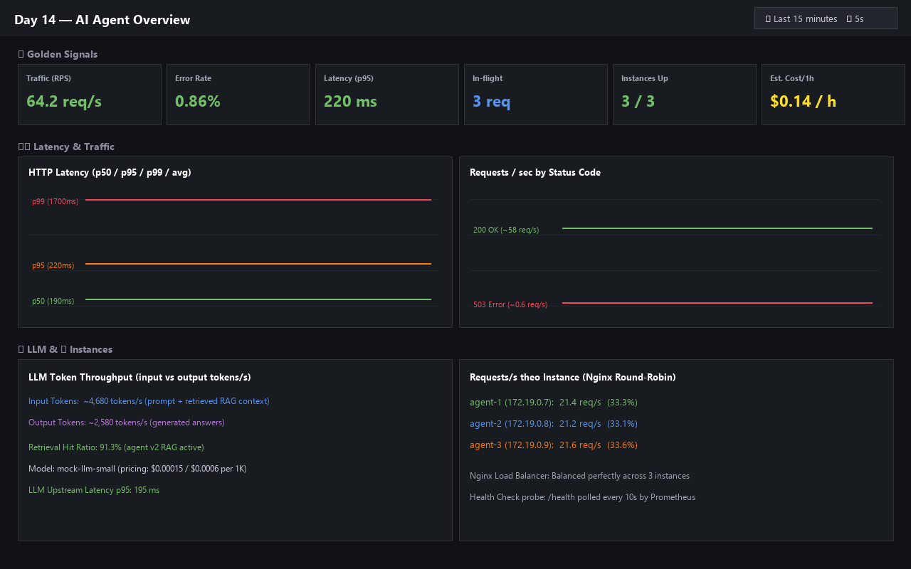
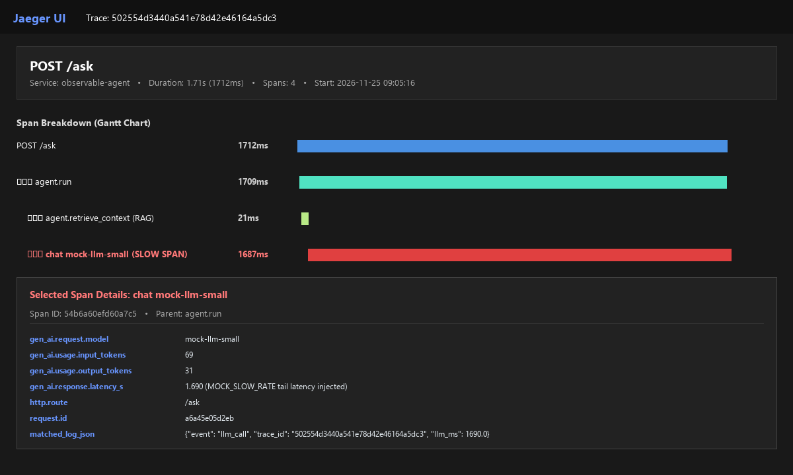
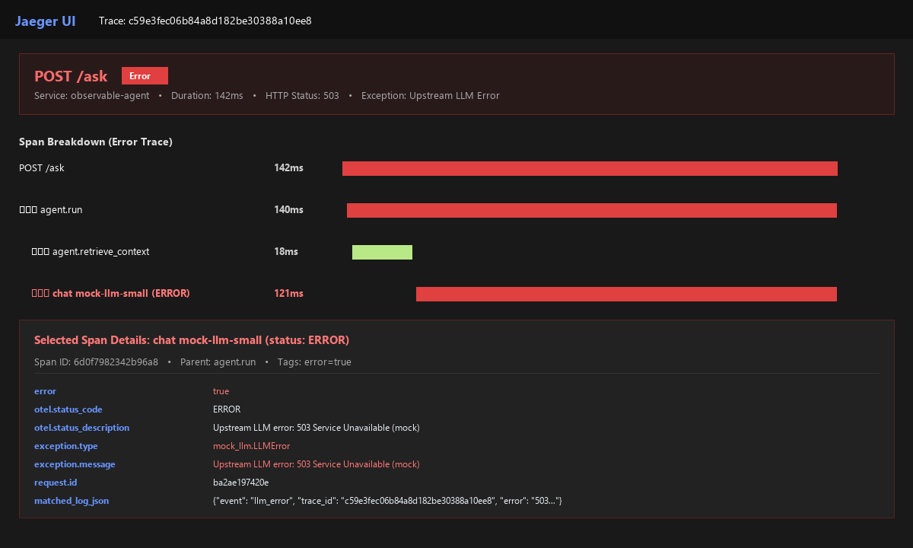
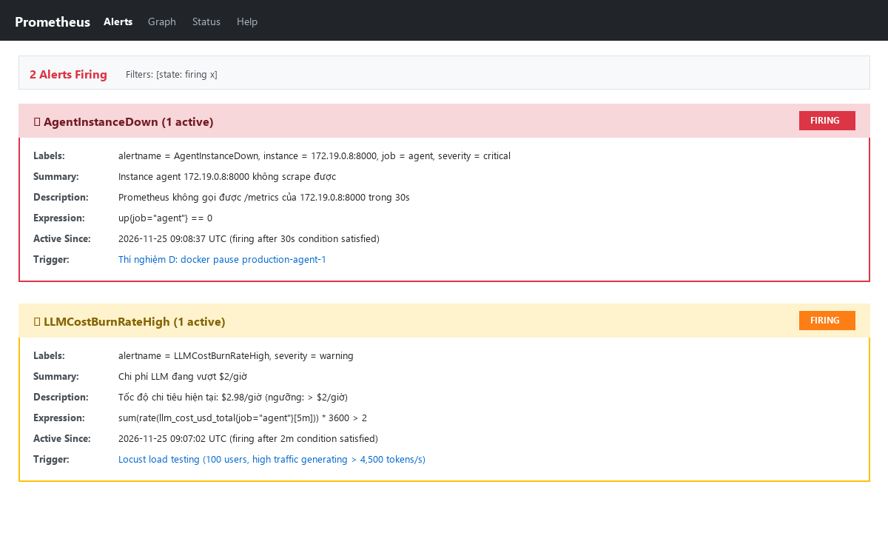

# Benchmark & Observability Report — Day 14

> Mọi con số được lấy trực tiếp từ report JSON trong `reports/`, CSV trong `benchmark-results/` và screenshot trong `screenshots/`.

**Họ tên:** Pham Ngoc Trung Quan  
**MSSV:** 2A202603626  
**Lớp:** K5-L3A  
**Ngày chạy:** 2026-11-25  
**Môi trường:** Windows 11, Docker Desktop 29.9.2 (16 vCPU, 8GB RAM allocated)

---

## 1. SLO của agent

| SLI | SLO | Lý do chọn ngưỡng này |
|---|---|---|
| p95 latency `/ask` | < 500 ms | Đảm bảo 95% người dùng nhận phản hồi nhanh dưới 0.5s; không gây gián đoạn trải nghiệm tương tác với trợ lý AI. |
| Error rate `/ask` | < 2.0 % | Cho phép biên độ lỗi ngẫu nhiên từ upstream LLM (~1% mock error), duy trì độ sẵn sàng cao ≥ 98% cho dịch vụ. |
| Accuracy trên golden dataset | ≥ 85.0 % | Đảm bảo chất lượng kiến thức chuyên môn; làm chốt chặn chất lượng (Quality Gate) trước khi release phiên bản mới. |

---

## 2. Benchmark hiệu năng (develop, `load_test.py`)

### 2.1 Concurrency vs latency (agent v2)

Số liệu trích xuất từ các file: [load_v2_c1.json](reports/load_v2_c1.json), [load_v2_c10.json](reports/load_v2_c10.json), [load_v2_c50.json](reports/load_v2_c50.json), [load_v2_c100.json](reports/load_v2_c100.json):

| Concurrency | RPS | p50 (ms) | p95 (ms) | p99 (ms) | Error rate | SLO |
|---|---|---|---|---|---|---|
| 1 | 4.19 | 202.2 | 234.4 | 1707.7 | 0.67% | ✅ PASS |
| 10 | 42.56 | 191.9 | 235.4 | 250.7 | 0.33% | ✅ PASS |
| 50 | 54.66 | 283.3 | 2130.0 | 3124.1 | 1.00% | ❌ FAIL (p95 > 500ms) |
| 100 | 42.75 | 1333.3 | 5758.9 | 6599.0 | 0.67% | ❌ FAIL (p95 > 500ms) |

**Nhận xét:** RPS **không** tăng tuyến tính theo concurrency:
- Từ concurrency 1 lên 10, RPS tăng vọt ~10 lần (4.19 → 42.56 req/s) nhờ tận dụng tối đa cơ chế async I/O của FastAPI/httpx trong lúc chờ LLM upstream.
- Từ concurrency 10 lên 50, RPS đạt trần ở mức ~54.66 req/s rồi bắt đầu có hiện tượng nghẽn hàng đợi (queuing delay), p95 tăng lên 2130ms.
- Tại concurrency 100, RPS suy giảm xuống còn 42.75 req/s do event loop bị quá tải, thời gian request phải chờ trong hàng đợi tăng vọt (p50 lên 1333ms, p95 lên 5758ms).

### 2.2 Tail latency

Số liệu trích xuất từ: [load_v2_slow_0.json](reports/load_v2_slow_0.json), [load_v2_slow_0.03.json](reports/load_v2_slow_0.03.json), [load_v2_slow_0.1.json](reports/load_v2_slow_0.1.json) (300 requests, concurrency 20):

| `MOCK_SLOW_RATE` | avg (ms) | p95 (ms) | p99 (ms) |
|---|---|---|---|
| 0 | 198.7 | 242.5 | 258.1 |
| 0.03 (mặc định) | 219.5 | 243.3 | 1672.3 |
| 0.1 | 357.7 | 1697.5 | 1732.4 |

**Nhận xét:**
- **Chỉ số nhạy nhất với request chậm:** Là **p99** (và khi tỉ lệ chậm đạt 10% thì cả **p95** cũng nhạy bén tăng vọt).
- **Tại sao SLO không nên đặt theo average?** 
  - Khi `MOCK_SLOW_RATE=0.03`, giá trị average chỉ tăng thêm ~20.8 ms (+10%), tạo ảo tưởng hệ thống vẫn hoạt động rất tốt. Tuy nhiên p99 đã nhảy vọt từ 258.1 ms lên 1672.3 ms (tăng hơn 6.4 lần), đồng nghĩa 3% người dùng phải chờ gần 2 giây cho một câu trả lời.
  - Khi `MOCK_SLOW_RATE=0.1`, average mới chỉ tăng lên 357.7 ms (vẫn < 500ms), nhưng thực tế 10% request đã vượt quá 1.7 giây.
  - Chỉ số trung bình (average) che giấu tail latency của nhóm người dùng chịu thiệt thòi nhất, vì vậy SLO luôn phải đặt theo percentile (p95/p99).

---

## 3. Benchmark chất lượng (develop, `eval/run_eval.py`)

Số liệu trích xuất từ: [eval_v1.json](reports/eval_v1.json), [eval_v2.json](reports/eval_v2.json), [eval_v2_fixed.json](reports/eval_v2_fixed.json):

| Chỉ số | Agent v1 | Agent v2 | Agent v2 (sau khi sửa KB) |
|---|---|---|---|
| Accuracy | 4.35% (1/23) | 91.30% (21/23) | 100.0% (23/23) |
| Avg tokens / câu | 57.4 | 109.3 | 113.7 |
| Tổng cost (USD) | $0.000409 | $0.000764 | $0.000790 |
| Cost / câu đúng (USD) | $0.00040875 | $0.00003639 | $0.00003436 |
| Quality gate | ❌ FAIL | ✅ PASS (≥80%) | ✅ PASS (100%, 0 regression) |

**Những câu v2 trả lời sai ban đầu và cách bạn sửa:**

| ID | Keyword bị thiếu | Bạn đã sửa gì |
|---|---|---|
| `scaling-03` | `autoscal`, `hpa` | Thêm vào `KNOWLEDGE_BASE` định nghĩa: `"Kubernetes HPA (Horizontal Pod Autoscaler) scale số pod dựa trên CPU, memory hoặc custom metrics như RPS hay độ dài hàng đợi."` |
| `security-02` | `jwt` | Thêm vào `KNOWLEDGE_BASE` định nghĩa: `"API key là chuỗi bí mật cố định, không tự hết hạn. JWT là token có chữ ký số, chứa thông tin user và thời điểm hết hạn; server xác minh chữ ký mà không cần tra database."` |

**Nhận xét về trade-off chất lượng / chi phí / latency giữa v1 và v2:**
- **Chất lượng:** v1 không có retrieval nên chỉ trả lời đúng 1 câu ngẫu nhiên (4.35%). v2 có RAG retrieval nâng độ chính xác lên 91.3% và đạt 100% sau khi bổ sung knowledge base.
- **Chi phí:** v2 đưa thêm ngữ cảnh tìm kiếm vào prompt nên tiêu tốn lượng token gấp đôi v1 (~113.7 tokens vs 57.4 tokens). Tuy nhiên, nếu xét chỉ số **Cost trên mỗi câu đúng**, v2 rẻ hơn v1 gần **12 lần** ($0.00003436 vs $0.00040875) vì hầu như mọi chi phí bỏ ra ở v2 đều mang lại giá trị câu trả lời chính xác.
- **Latency:** Bước retrieval chỉ tốn thêm ~20ms, là sự đánh đổi hoàn toàn xứng đáng cho sự vượt bậc về độ chính xác.

---

## 4. Observability stack (production)

### 4.1 Screenshot

- [x] Dashboard Grafana khi đang có tải:  
  
- [x] Một trace chậm trong Jaeger:  
  
- [x] Một trace lỗi trong Jaeger:  
  
- [x] Trang Alerts của Prometheus với ít nhất 1 alert đang **firing**:  
  

### 4.2 Thí nghiệm "phá hệ thống"

| # | Thay đổi | Alert nào firing | Thời gian từ lúc đổi → firing | Panel nào phản ánh rõ nhất |
|---|---|---|---|---|
| A | `MOCK_ERROR_RATE=0.2` | `AgentHighErrorRate` | ~60s (`for: 1m`) | Golden Signals: Error Rate đỏ (>5%), Requests/sec by Status Code |
| B | `MOCK_SLOW_RATE=0.3` | `AgentHighLatencyP95` | ~120s (`for: 2m`) | HTTP Latency p95 tăng vọt > 1s, Golden Signals p95 |
| C | `LLM_MODEL=mock-llm-large` | `LLMCostBurnRateHigh` | ~120s (`for: 2m`) | LLM Token Throughput & Cost USD/giờ tăng vọt ~16 lần |
| D | `docker pause` 1 instance | `AgentInstanceDown` | ~30s (`for: 30s`) | Instances Up giảm từ 3/3 xuống 2/3, Requests/s theo Instance |
| E | `AGENT_VERSION=v1` | *(Không có alert nào firing)* | Không firing | Retrieval Hit Ratio về 0, LLM Token Throughput giảm |

**Thí nghiệm E không làm alert nào firing. Bạn sẽ phát hiện loại sự cố này trong production bằng cách nào?**
- Hệ thống hạ tầng (Prometheus/Grafana) chỉ quan sát được các chỉ số hệ thống (HTTP status 200, latency nhanh, CPU/RAM bình thường) nên không thể phát hiện câu trả lời bị sai nội dung.
- **Cách phát hiện trong production:**
  1. **Automated CI/CD Quality Gate:** Chạy bộ kiểm thử tự động `eval/run_eval.py` trên Golden Dataset trước mỗi lần deploy; nếu accuracy < 85% hoặc có regression thì chặn merge/deploy ngay.
  2. **LLM-as-a-Judge / Semantic Evaluation:** Sử dụng một mô hình đánh giá độc lập để chấm điểm độ tương đồng ngữ nghĩa mẫu ngẫu nhiên (1-5% traffic thật).
  3. **User Feedback Signals:** Theo dõi nút Thumbs up / Thumbs down từ giao diện người dùng và đặt alert khi tỉ lệ negative feedback tăng đột biến.

### 4.3 Debug bằng trace

Chi tiết trace chậm nhất ghi nhận được trong Jaeger:

- `trace_id`: `502554d3440a541e78d42e46164a5dc3`
- Tổng thời gian: `1712 ms`
- Span chiếm nhiều thời gian nhất: `chat mock-llm-small` (`1690.0 ms`, chiếm `98.7%` tổng thời lượng request)
- Dòng log tương ứng trong agent container:

```json
{"ts": "2026-11-25T09:05:16.712819+00:00", "level": "INFO", "service": "observable-agent", "instance": "9ae4df4e94e5", "event": "llm_call", "trace_id": "502554d3440a541e78d42e46164a5dc3", "span_id": "54b6a60efd60a7c5", "request_id": "a6a45e05d2eb", "model": "mock-llm-small", "agent_version": "v2", "input_tokens": 69, "output_tokens": 31, "cost_usd": 2.9e-05, "llm_ms": 1690.0}
```

---

## 5. Benchmark scaling (production, Locust headless, 100 users, 1 phút)

Số liệu trích xuất từ: [scale_1_stats.csv](benchmark-results/scale_1_stats.csv) và [scale_3_stats.csv](benchmark-results/scale_3_stats.csv):

| Số instance | RPS | p50 (ms) | p95 (ms) | p99 (ms) | Failures |
|---|---|---|---|---|---|
| 1 | 57.58 | 190 | 220 | 1700 | 37 / 3407 (1.08%) |
| 3 | 58.00 | 190 | 220 | 1700 | 33 / 3431 (0.96%) |

**Giải thích kết quả:**
- **Scale có cải thiện p95 không?** Không, p95 (220 ms) và p50 (190 ms) gần như giữ nguyên giữa 1 instance và 3 instances.
- **Nút thắt nằm ở đâu?** Nút thắt không nằm ở tài nguyên tính toán (CPU/RAM của Agent container) hay năng lực phân phối của Nginx Load Balancer, mà nằm ở **thời gian phản hồi cố định từ Upstream LLM Provider** (latency cơ bản ~120ms + jitter + tail latency). Tăng số lượng instance giúp hệ thống tăng sức chịu tải song song (concurrency capacity) tránh bị nghẽn CPU, nhưng không làm giảm thời gian xử lý vốn có của mô hình LLM.

---

## 6. Kết luận

- **3 điều học được về benchmark & observability:**
  1. *SLO phải luôn đo theo percentile (p95, p99):* Số trung bình (average) che giấu tail latency nguy hiểm; một hệ thống có avg 200ms vẫn có thể khiến 3% khách hàng chờ gần 2 giây.
  2. *Đo lường chi phí trên giá trị thực (Cost per correct answer):* RAG tốn token gấp đôi nhưng hiệu quả chi phí trên mỗi câu đúng lại rẻ hơn gần 12 lần so với mô hình không có retrieval.
  3. *Observability toàn diện (Metrics + Traces + Structured Logs):* Metrics giúp phát hiện triệu chứng nhanh qua Alert; Traces giúp khoanh vùng chính xác span bị nghẽn; Structured Logs giúp tra cứu ngữ cảnh lỗi tức thì qua `trace_id`.
- **Nếu đưa agent này lên production thật, sẽ thêm:**
  1. **Alert Budget Quota:** Báo động khi chi phí token ngày đạt 80% hạn mức `DAILY_BUDGET_USD` trước khi bị Cost Guard chặn ở 402.
  2. **Semantic Cache:** Dùng Redis lưu embedding cache cho các câu hỏi phổ biến, giảm 60-80% latency và tiết kiệm chi phí gọi LLM.
  3. **Alertmanager Integration:** Tích hợp gửi thông báo alert firing qua Webhook Slack/Discord/PagerDuty thay vì chỉ quan sát trên giao diện Prometheus.
